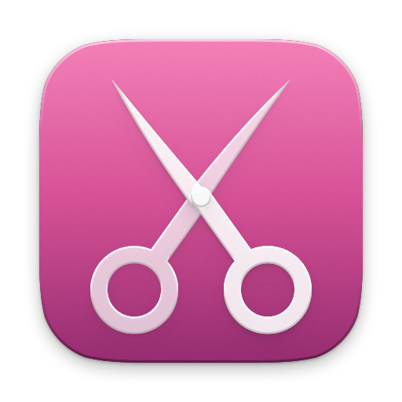

# Cut

Cut trims and splits video and audio without re-encoding: open a file, mark the parts you want on the timeline, export them in seconds, at the original quality.

Cut is [LosslessCut](https://github.com/mifi/lossless-cut) 3.70.2 by Mikael Finstad, restyled for macOS and the rest of the suite. Everything works as in LosslessCut, with the same layout: the player, the timeline with segments, thumbnails, keyframes and waveform, the segment list, tracks, export options, settings, keyboard shortcuts, menus, CLI and HTTP API. Only the look changed.

## Features (from LosslessCut)

- Cut and trim video and audio losslessly, in seconds
- Merge cut segments, or whole files with identical codecs, losslessly
- Add, remove, replace or extract tracks: audio, subtitles and more
- Change the format (remux), for example from MKV to MP4, without re-encoding
- Segments, markers and tags, with import/export of chapters, CSV, EDL and more
- Detect scenes, black frames and silence, and split by them
- Edit metadata and rotation, and create chapters
- Opens almost any format, even ones your player can't play
- Snapshots and frame export, keyboard shortcuts, a CLI and an HTTP API

The documentation of LosslessCut applies as is: https://losslesscut.app/docs (the upstream README is in `docs/LosslessCut-README.md`).

## What changed from LosslessCut

- **Window**: a macOS window: the top bar is the title bar, beside the traffic lights, and moves the window.
- **Colours**: the system blue as accent (LosslessCut: cyan), macOS greys for bars, panels and the timeline, light and dark mode following the system by default (Settings › theme still switches it).
- **Font**: the system font (SF Pro) instead of Open Sans, a little smaller, as in native apps.
- **Icons**: one consistent outline set (Lucide, close to the macOS symbols) instead of a mix of Font Awesome, Ionicons and Material icons; same meaning in the same places (`src/renderer/src/icons.ts` maps each one).
- **Controls**: macOS-style buttons and pop-up menus (rounded, hairline border, up/down chevrons), rounded segment buttons, a thin rounded drop area.
- **Dialogs**: Settings, Export options and alerts are solid panels with rounded corners and a soft shadow, instead of blurred glass over the video.
- **Segments**: coloured with the macOS system palette.
- **Name and icon**: Cut, with its own icon and bundle id (`local.cut.Cut`), so its settings are kept apart from LosslessCut's.
- **Offline**: no update check (it would offer LosslessCut releases) and no news/donation banner from the LosslessCut site.

## Building

Needs Node.js (the repository's own Yarn is used) and the Xcode command line tools.

```
macos/setup-signing.sh   # once: local signing identity in signing/
macos/build-app.sh       # installs dependencies and FFmpeg if needed, builds, signs, installs in /Applications
macos/make-dmg.sh        # installer: build/Cut-<version>.dmg
```

Apple Silicon. `macos/make-icon.swift` draws the icon. FFmpeg and ffprobe come from LosslessCut's own build (`script/downloadFfmpeg.ts`).

Development: `script/dev-run.sh <snapshot-dir> <config-dir> [file]` builds, runs with a scratch config folder and the HTTP API on port 18321, and writes a PNG of the window every second (`--cut-snapshot <dir>`), so the layout can be checked without screen recording; actions can be triggered with `curl -X POST http://127.0.0.1:18321/api/action/<action>`.

## License

GPL v2, as LosslessCut (see `LICENSE`). LosslessCut © 2016–2026 Mikael Finstad; the changes listed above are by bennhouse. FFmpeg is GPL.
